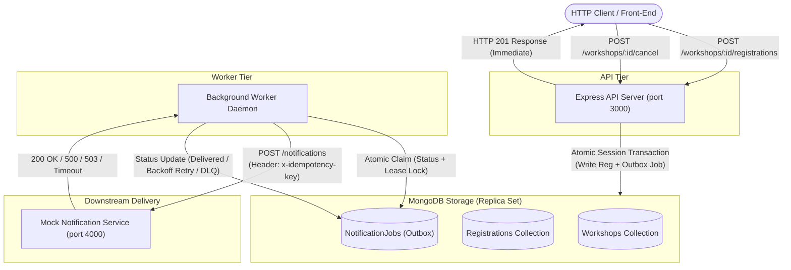
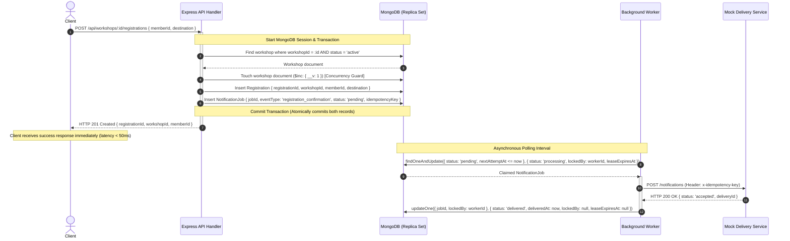
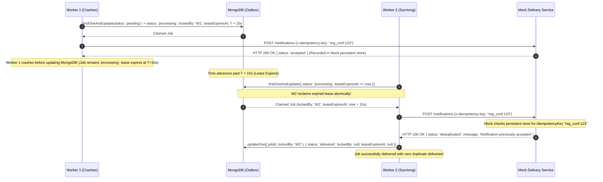

# Architecture & System Design

This document describes the high-level architecture, transactional outbox pattern, lease-based worker scheduling, and concurrency control implemented in the Workshop Registration and Notifications system.

---

## 1. System Overview

The system is partitioned into three decoupled execution components:

1. **API Server (`src/server.js`)**: An Express HTTP server handling client requests for workshops, registrations, and cancellations. It performs transactional database writes using MongoDB multi-document transactions.
2. **Transactional Outbox (`NotificationJob` collection)**: A persistent MongoDB queue storing events (`registration_confirmation`, `workshop_cancellation`) atomically with domain state changes.
3. **Background Worker (`src/workers/workerRunner.js`)**: An autonomous, poll-based daemon that claims jobs via atomic lease acquisition, manages exponential backoff retries, and forwards notifications to downstream delivery targets.
4. **Mock HTTP Notification Service (`src/notification-mock/mockServer.js`)**: An external delivery endpoint providing configurable failure simulations and deduplication via stable idempotency keys.



---

## 2. Sequence Diagram: Member Registration & Transactional Outbox

This diagram illustrates how member registration achieves zero data loss and immediate HTTP responses without blocking on network latency.



---

## 3. Sequence Diagram: Workshop Cancellation & Failure Isolation

When a workshop is cancelled, all existing registrations are converted into independent cancellation notification jobs in a single transaction. If one recipient's destination fails, other recipients are delivered without stalling.

```mermaid
sequenceDiagram
    autonumber
    actor Organizer
    participant API as Express API Handler
    participant Mongo as MongoDB
    participant Worker as Background Worker
    participant Mock as Mock Delivery Service

    Organizer->>API: POST /api/workshops/:id/cancel
    activate API
    Note over API,Mongo: Start Session & Transaction
    API->>Mongo: findOneAndUpdate({ workshopId: :id, status: 'active' }, { status: 'cancelled' })
    Mongo-->>API: Updated workshop
    API->>Mongo: Find all registrations for workshopId
    Mongo-->>API: [Reg A (Alice), Reg B (Bob), Reg C (Charlie)]
    API->>Mongo: insertMany([Job Alice, Job Bob, Job Charlie]) with unique idempotency keys
    Note over API,Mongo: Commit Transaction
    API-->>Organizer: HTTP 200 OK { status: 'cancelled', meta: { jobsCreated: 3 } }
    deactivate API

    Note over Worker: Worker claims jobs concurrently
    par Process Alice
        Worker->>Mock: POST /notifications (Alice)
        Mock-->>Worker: HTTP 200 OK
        Worker->>Mongo: updateOne(Alice -> delivered)
    and Process Bob (Failing destination)
        Worker->>Mock: POST /notifications (Bob)
        Mock-->>Worker: HTTP 500 Internal Server Error
        Worker->>Mongo: updateOne(Bob -> pending, nextAttemptAt = now + backoff, attemptCount = 1)
        Note over Worker: Bob is rescheduled for retry; does not block Alice or Charlie!
    and Process Charlie
        Worker->>Mock: POST /notifications (Charlie)
        Mock-->>Worker: HTTP 200 OK
        Worker->>Mongo: updateOne(Charlie -> delivered)
    end
```

---

## 4. Sequence Diagram: Worker Crash Recovery & Mock Idempotency

This diagram details the lease recovery mechanism when a worker crashes after claiming a job or after downstream delivery acceptance.



---

## 5. Database Schema & Index Specifications

### 5.1 Workshops Collection
- `workshopId` (String, Unique Index)
- `title` (String, Trimmed, Required)
- `description` (String, Trimmed, Required)
- `organizerId` (String, Required)
- `status` (`'active'` | `'cancelled'`, Indexed)
- `createdAt`, `updatedAt` (Timestamps)

### 5.2 Registrations Collection
- `registrationId` (String, Unique Index)
- `workshopId` (String, Indexed)
- `memberId` (String, Indexed)
- `destination` (String, Trimmed, Required)
- `createdAt` (Date, default `Date.now`)
- **Compound Unique Index**: `{ workshopId: 1, memberId: 1 }` (unique constraint prevents duplicate registrations)

### 5.3 NotificationJobs Collection (Outbox)
- `jobId` (String, Unique Index)
- `eventType` (`'registration_confirmation'` | `'workshop_cancellation'`, Indexed)
- `workshopId` (String, Indexed)
- `registrationId` (String, Nullable, Indexed)
- `recipientId` (String, Indexed)
- `destination` (String, Required)
- `status` (`'pending'` | `'processing'` | `'delivered'` | `'dead_lettered'`, Indexed)
- `attemptCount` (Number, default 0)
- `maxAttempts` (Number, default 5)
- `nextAttemptAt` (Date, Indexed)
- `lastError` (Mixed: `{ message, status, timestamp }`)
- `idempotencyKey` (String, Unique Index)
- `payload` (Mixed)
- `leaseExpiresAt` (Date, Nullable, Indexed)
- `lockedBy` (String, Nullable)
- `deliveredAt` (Date, Nullable)
- **Compound Polling Index**: `{ status: 1, nextAttemptAt: 1 }`
- **Compound Lease Index**: `{ status: 1, leaseExpiresAt: 1 }`
- **Workshop Multi-Event Index**: `{ workshopId: 1, eventType: 1, recipientId: 1 }`
